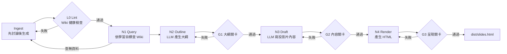

## 112306022 資管四 許巧璇

## 一、LLM Wiki 主題與簡介

**主題：Multi-Agent System (MAS) 是什麼？何時該讓多個AI合作？**

MAS 是讓多個 LLM agent 分工合作、共同完成任務的系統。multi agent近年來是個常被討論與使用的架構，但業界和學界的看法不一致：Anthropic 說多代理讓表現提升 90.2%，Cognition 卻直接主張「不要做多代理」。我希望整理出一份能讓沒做過 agent 系統的同學看懂、而且能判斷「什麼時候該用、什麼時候不該用」的 Wiki。

**Wiki 規模**：ingest 6 篇資料，產生 6 個來源頁、9 個概念頁、1 個比較頁，另有總覽、術語表（14 個術語）、索引與操作紀錄。

| ID | 來源 | 類型 |
|----|------|------|
| S1 | Anthropic — Building Effective Agents (2024-12) | 工程實務指南 |
| S2 | Anthropic — How we built our multi-agent research system (2025-06) | 實際系統案例（正方） |
| S3 | Cognition — Don't Build Multi-Agents (2025-06-12) | 業界觀點（反方） |
| S4 | Cemri et al. — Why Do Multi-Agent LLM Systems Fail? (NeurIPS 2025) | 學術實證研究 |
| S5 | LangChain / LangGraph Docs — Multi-agent systems | 框架官方文件 |
| S6 | OpenAI — A practical guide to building agents (2025) | 工程實務指南 |

來源包含正方、反方與學術研究，讓 Wiki 能呈現不同觀點，而不是單方面說 MAS 很好。

### Wiki 的規則(claude.md檔)

- **三層結構**：`raw/` 來源卡（只增不改）→ `wiki/` 知識頁 → `CLAUDE.md` 規則層。
- **每個事實句都要標來源 ID**（如 `[S2]`），沒有來源的句子標 `[推論]`；數字必須和來源完全一致。

### 「先討論、後生成」怎麼做

每篇來源 ingest 時，先不寫 Wiki，而是讓 LLM 列出 3～5 個 key takeaways、判斷這篇和現有 Wiki 是「補充」還是「衝突」，由我決定要強調什麼，再開始生成。討論結果記錄在每個來源頁開頭的「先討論紀錄」。幾個實際影響 Wiki 的討論：

| 來源 | 討論的問題 | 決定 |
|---|---|---|
| S2 | 「+90.2%」放進簡報，會不會讓人以為 MAS 一定比較好？ | 這個數字一定要和「token 用量約 15 倍」放在同一頁，避免單面呈現 |
| S3 | S2 說 MAS 好、S3 說不要做，是不是矛盾？ | 不是矛盾，而是任務類型不同（可平行的研究 vs 高度依賴的寫程式）。另開比較頁 `single-vs-multi-agent` 寫出這個調和 |
| S4 | 14 種失敗模式全放進簡報會不會太多？ | 簡報只放 3 大類，完整 14 種留在 Wiki |
| S6 | OpenAI 的 manager / decentralized 和 LangGraph 的 supervisor / network 是同一件事嗎？ | 是同一概念的不同叫法，在 `mas-architectures` 加入名詞對照表，避免新手混淆 |

## 二、成果連結

- **LLM Wiki**：https://chhiao.github.io/LLM-wiki/dist/wiki.html
- **教學 HTML 簡報**：https://chhiao.github.io/LLM-wiki/dist/slides.html
- **GitHub（原始檔、程式、執行紀錄）**：https://github.com/chhiao/LLM-wiki

### 簡報結構

| 段落 | 頁 | 內容 |
|---|---|---|
| 開場 | 1–2 | 標題、今天要學會的 4 件事 |
| 先懂單一 agent | 3–5 | agent 三元件、run loop、Workflow vs Agent |
| MAS 是什麼 | 6–8 | 為什麼要拆、中央指揮型、交接型（Handoff） |
| 正反兩面 | 9–13 | Anthropic 案例（+90.2% / 15 倍 token）、Cognition 反方（Flappy Bird 例子）、Context Engineering、失敗模式、驗證 |
| 實務判斷 | 14 | 「我該用多代理嗎？」四步判斷流程 |
| 檢核 | 15–16 | 3 題互動小測驗、重點回顧 |

### Wiki 與簡報如何對應

- 簡報下方有「📖」按鈕，會在側邊打開對應的 Wiki 頁面，可直接查證內容。
- 每個重點後面都有來源標籤（S1～S6），點了會打開該來源的摘要頁。
- 每個新術語第一次出現時，標題旁會標出「新名詞」，對應 Wiki 的術語表。
- 以上對應關係都由 pipeline 的關卡自動檢查（見下一節）。

## 三、Loop / Graph 設計

### 流程圖

文字版：**取得資料（Ingest）→ 檢查 Wiki（L0）→ 查詢 Wiki（N1）→ 整理大綱（N2）→ 檢查大綱（G1）→ 撰寫內容（N3）→ 檢查內容（G2）→ 產生簡報（N4）→ 檢查呈現（G3）**

### 每個節點做什麼

| 節點 | 類型 | 做什麼 | 輸出 |
|---|---|---|---|
| L0 Lint | 程式檢查 | 斷掉的連結、孤兒頁、缺來源的事實句、不存在的來源 ID | — |
| N1 Query | 程式 | 讀 `objectives.json` 的 8 個學習目標，先讀 index，再用關鍵字找出每個目標最相關的 3 個 Wiki 頁 | `query_result.json` |
| N2 Outline | **LLM** | 依查詢結果寫大綱：每頁負責哪個學習目標、引用哪些 Wiki 頁、定義哪些術語、預計用哪些數字 | `outline.json` |
| G1 大綱關卡 | 程式檢查 | 8 個學習目標都有頁負責；每頁都有 Wiki 來源；開頭有學習目標、結尾有測驗與回顧 | — |
| N3 Draft | **LLM** | 依大綱寫每一頁的重點句、來源標記、圖示與測驗題 | `slides.json` |
| G2 內容關卡 | 程式檢查 | 每句有來源；引用的來源在指定 Wiki 頁裡；**數字能在 Wiki 找到**；**術語先定義再使用**；每頁最多 5 點、每句最多 70 字 | — |
| N4 Render | 程式 | 產生單一 HTML，內嵌 Wiki 對照面板 | `slides.html` |
| G3 呈現關卡 | 程式檢查 | 頁數正確、沒有空白頁、每頁都有 Wiki 對照連結、鍵盤導覽可用、測驗都有正確答案；v2 再用 headless 瀏覽器實際打開每一頁檢查版面 | — |

### 哪些步驟會重複執行？

- **N2 → G1** 和 **N3 → G2** 是兩個主要的 loop：LLM 生成後由程式檢查，失敗就把錯誤訊息交回 LLM 重新生成，最多重試 3 次。
- **N4 → G3**：版面檢查失敗時，修改 HTML 樣式後重新 render。
- **Ingest → L0**：Wiki 本身有問題時，回到 Wiki 修正；N1 如果發現某個學習目標在 Wiki 裡查不到資料，也會回到 Ingest 補資料。

### 哪些地方需要檢查或重新生成？

需要重新生成的是兩個 **LLM 節點（N2、N3）**，因為只有它們可能產生「幻覺」：編造 Wiki 裡沒有的數字、引用錯來源、還沒解釋就先用術語。所以每個 LLM 節點後面都緊接一個**程式關卡**，用確定性的規則檢查，而不是再請另一個 LLM 判斷。

### 為什麼這樣設計？

1. **參考 S4（MAST）的研究結論**：多代理系統約 24% 的失敗來自驗證不足，而且驗證者常常只做表面檢查（例如程式能不能編譯）。所以我設計了三層關卡，而且每一層都檢查**高層目標**（學習目標有沒有被涵蓋、內容是否可追溯到 Wiki、新手是否看得懂），而不只是「HTML 能不能開」。
2. **參考 S1 的建議**：任務流程固定、可預測時，用 workflow 就夠了，不需要讓 agent 自由決定。簡報產生的步驟是固定的，所以我用 **prompt chaining + evaluator-optimizer** 的 workflow，而不是多代理系統。這正好就是簡報第 14 頁「先問：一次呼叫夠不夠？需要 agent 嗎？」的實際應用。
3. **檢查用程式而不是 LLM**：數字比對、術語順序、引用來源這些規則都可以精確定義，用程式檢查結果穩定、可重現，每次的結果都能寫進執行紀錄。

## 四、實際執行結果與檢查紀錄

完整紀錄由 pipeline 自動寫入 `runs/run_log.jsonl`，整理成表格在 [`runs/run_log.md`](https://github.com/chhiao/LLM-wiki/blob/main/runs/run_log.md)。以下是重點：

| # | graph | 節點 | 結果 | 抓到的問題 | 處理方式 |
|---|---|---|---|---|---|
| 1 | v1 | L0 Lint | ❌ 4 項 | `context-engineering`、`failure-modes-mast` 有 4 句事實句缺來源標記 | 回到 Wiki 補標 `[S3]`、`[S4]` |
| 3 | v1 | L0 Lint | ✅ | — | — |
| 4 | v1 | G1 大綱 | ✅ | — | — |
| 5 | v1 | G2 內容 | ❌ 3 項 | 見下方 | 回 N2/N3 修正 |
| 7 | v1 | G2 內容 | ✅ | — | — |
| 9 | v1 | G3 呈現 | ✅ | — | — |
| 10 | v2 | G3 呈現（加入瀏覽器檢查） | ❌ 22 項 | 16 頁全部「導覽按鈕遮住頁尾」、6 頁「內容只占上半部」 | 修改 CSS：導覽列移到右上角、內容垂直置中 |
| 13 | v2 | G3 呈現 | ✅ | — | — |
| 14 | v1 | G1（回歸測試） | ✅ 0 項 | 用原始大綱重跑，v1 的 G1 **一個都沒抓到** | — |
| 15 | v2 | G1（回歸測試） | ❌ 3 項 | 用原始大綱重跑，v2 的 G1 **3 個全抓到** | 證明檢查前移有效 |
| 16–21 | v2 | 全流程 | ✅  | — | — |

**#5 G2 抓到的 3 個問題（v1 第一次執行）：**

1. **s13「所以要驗證」**：寫了「ChatDev 成功率最多 +15.6%」，但這頁指定的 Wiki 頁 `verification-and-evaluation` 裡沒有這個數字（它其實在 `failure-modes-mast`）。→ 大綱的 `wiki_refs` 補上 `failure-modes-mast`，讓數字可以追溯。
2. **s15 小測驗**：題目寫「同時調查 **50** 家公司的董事會成員」，50 是 LLM 自己編的數字，Wiki 裡沒有。→ 拿掉數字，改成「很多家公司」。
3. **s04 run loop**：這頁就用到「Multi-Agent System」，但這個術語要到 s06 才定義。→ 改寫句子，不在 s04 提到 MAS。

## 五、反思

### 1. 哪一個節點最常出錯？

**最常出錯的是 LLM 生成節點，尤其是 N2 大綱。** 表面上看，失敗都出現在 G2 內容關卡，但追查 3 個問題的來源後發現，**它們在大綱階段就已經埋下了**：

- 15.6% 的問題，是大綱階段就把 `wiki_refs` 指錯頁；
- 50 家公司的數字，是大綱的 `key_facts` 裡就寫了；
- s04 的術語問題，是大綱的 `terms_used` 裡就列了 MAS。

也就是說，N3 只是忠實照著有問題的大綱寫，錯誤一路傳到 G2 才被發現。這時候要修，必須 N2、N3 兩個節點都重新生成，成本較高。這也呼應 S4 提到的「錯誤會在系統裡累積」。

另一個發現是：**G3 原本的檢查太表面**。v1 的 G3 只檢查 HTML 結構，所以第一次就通過了；但我實際打開簡報截圖，才發現導覽按鈕擋住了每一頁的頁碼和 Wiki 對照按鈕。這正好是 S4 說的「驗證只做表面檢查」。

### 2. 發現問題後，把檢查往前移到哪一個步驟？

**把「數字可追溯」和「術語先定義後使用」兩項檢查，從 G2 內容關卡往前移到 G1 大綱關卡。**

做法是在大綱 JSON 裡要求 LLM 先寫出每頁「預計使用的數字」（`key_facts`）和「會用到的術語」（`terms_used`），G1 就能在還沒寫任何投影片內容前，先檢查：

- 這些數字能不能在指定的 Wiki 頁找到？
- 這些術語在前面的頁面定義過了嗎？

**驗證效果**：我用最原始、有錯誤的大綱做回歸測試，v1 的 G1 抓到 0/3 個問題，v2 的 G1 抓到 **3/3**（紀錄 #14、#15）。改版後的 v2 全流程一次通過（紀錄 #16～#21）。

### 3. 有沒有因此修改 workflow / graph？為什麼？

**有，從 v1 改成 v2，改了兩個地方：**

| 修改 | v1 | v2 | 原因 |
|---|---|---|---|
| 檢查前移 | 數字、術語在 G2 才檢查 | 提前到 G1 檢查 | 錯誤越早抓到，要重新生成的節點越少；在大綱階段修，只要重跑 N2，不用連 N3 一起重寫 |
| G3 加入視覺檢查 | 只檢查 HTML 結構 | 用 headless 瀏覽器實際打開每一頁，檢查內容溢出、按鈕遮擋、版面失衡 | 原本的檢查是表面檢查，HTML 結構正確不代表人看得清楚；要檢查「讀者真的看得到、看得懂」這個高層目標 |

這次最大的收穫是：**我做的簡報產生流程本身就是一個小型 agent 系統，而它遇到的問題，正好就是 Wiki 裡整理的 MAS 失敗模式**：錯誤在節點之間累積、驗證只做表面檢查。因此我照著 S4 的建議，把驗證做成多層、提前、檢查高層目標。這讓我對「為什麼要驗證」有比讀文章更深的理解。
